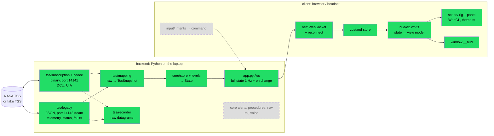
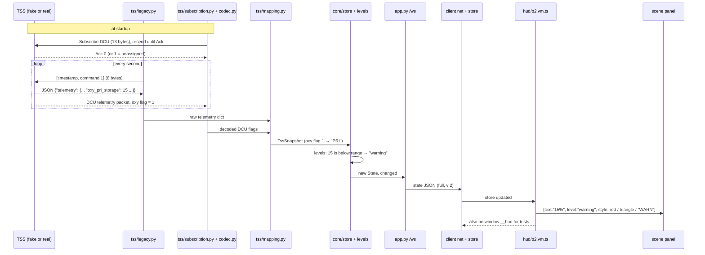

# M1 brief: walking skeleton

Written before building. Spec: [M1-walking-skeleton.md](../plan/milestones/M1-walking-skeleton.md). The builder session reads **Decisions taken** (section 11) and **Build workflow** (section 12) at the bottom.

**Interactive version:** [M1-explorer.html](M1-explorer.html) (open it in a browser). It has a clickable system map, an event stepper, a packet lab, levels, a link simulator, full state vs deltas, the head rig, and self-checks.

## 1. In one paragraph

After M1, **one suit value (primary oxygen %) and one switch (DCU oxygen PRI/SEC) travel from NASA's TSS to a 3D HUD panel**, plus a link status. The same panel appears on the laptop page and inside an emulated headset, where it follows your head. The milestone has almost no features on purpose. What it builds is the **pipe and its patterns**:
- a TSS adapter that speaks both TSS dialects
- a fake TSS, so nothing needs the real server
- record and replay
- one contract that generates the TypeScript types
- a test at every layer

Every later milestone copies these patterns. A shortcut taken here gets copied ten times, which is why this is the milestone with a Fable review afterwards.

### From what you built to M1

| You have today | M1 replaces it with | Why |
|---|---|---|
| `bridge/tss_client.py` asks for the whole EVA file (command 0) | `tss/legacy.py` asks for commands 1, 2 and 4, and `tss/subscription.py` + `codec.py` speak the new binary protocol | NASA removed command 0 on 2026-10-19, and DCU/UIA now come over the new protocol |
| `bridge/server.py` polls, records, replays and broadcasts | `app.py` (wiring) + `tss/recorder.py` + `sim/fake_tss.py` | Each job is a separate piece that can be tested on its own |
| Recordings of decoded JSON replies | Recordings of **raw datagrams** | A decoder change can be tested against old recordings |
| `bridge/levels.py` + `ranges.json` | Moved to `core/levels.py` + `data/ranges.json`, same logic | Your 12 tests stay. Only the location changes |
| Message v1 (`telemetry` / `tss_error`), shape written by hand in a doc | `state` v2, defined in Pydantic, with TS types generated | One source of truth, and a drift check fails the build |
| `hud/`: React DOM panels | `client/`: React + three.js panels drawn in WebGL | The Quest cannot show HTML in an immersive session |

## 2. Where it sits



Green parts are built in M1. Grey dashed parts come later (input in M2, the rest in M2–M6). The fake TSS (`sim/fake_tss.py`) sits where the TSS is. It is a real UDP server, so the backend cannot tell it from the real one.

## 3. One event, end to end

**The event:** primary oxygen drops to 15% while the oxygen switch is flipped to PRI. This is acceptance item 9, and it uses **both** TSS dialects, which is the main idea of M1.



What each arrow carries:
1. **Subscribe:** a 10-byte header + 2-byte device id + 1-byte XOR checksum, sent over UDP to port 14141. It's resent because UDP can drop it. Handled in `tss/subscription.py` and built by `codec.py`.
2. **Ack:** 1 byte. 0 = ok, 1 = your IP is not assigned to a team, so link becomes `unassigned`. Handled in `tss/subscription.py`.
3. **Legacy poll:** 8 bytes `uint32 time, uint32 command` sent to port `14142 + team`. The reply is JSON text for one section. Handled in `tss/legacy.py`.
4. **DCU push:** a binary packet at 1 Hz with 6 flag bytes. `codec.py` checks the length and checksum and raises a typed error if they're bad.
5. **Mapping:** both dialects merge into one `TssSnapshot`. Raw flags become words here and only here (`1 → "PRI"`). Handled in `tss/mapping.py`.
6. **Levels:** `core/levels.py` compares 15 with `data/ranges.json` and gets `warning`. The client never compares numbers.
7. **State:** the backend sends the whole state as JSON at once (because it changed) and again every second. Handled in `app.py`.
8. **View model:** a pure function turns state into strings and a style key. Handled in `client/src/hud/o2.vm.ts`.
9. **Draw:** the component looks up the colour, shape and word for `warning` in `theme.ts` and draws it in WebGL. Handled in `client/src/scene/`.

**The reverse case (link loss):** the TSS goes silent. `age_s` grows, and within 3 s `link.tss` becomes `unreachable` and values become `stale`. If the backend itself dies, the client's socket closes, the client shows offline and reconnects with backoff.

## 4. Contract changes

This is the first version of contract v2 (`backend/suits/contract.py`). Later milestones only add fields.

```json
{
  "type": "state", "v": 2, "seq": 1042, "t": 1794700000.2,
  "link": { "tss": "ok", "age_s": 0.4, "mode": "sim" },
  "eva":  { "started": true, "elapsed_s": 312, "phase": null },
  "suit": {
    "values": { "oxy_pri_storage": { "value": 15, "unit": "%", "level": "warning" } },
    "faults": { "fan": false, "oxy": false, "power": false, "scrubber": false }
  },
  "dcu": { "batt": "LOCAL", "oxy": "PRI", "comm": "B", "fan": "SEC", "pump": "CLOSED", "co2": "B" },
  "uia": { "eva_power": "OFF", "o2_supply": "CLOSED", "...": "..." }
}
```

`suit.values` holds all 23 telemetry values, not just oxygen. Only the panel is limited to one value. The field names above are illustrative, and the builder uses the TSS's own names. `TssSnapshot` is internal to the backend and is not sent to the client.

## 5. Files by responsibility

**Backend: `backend/suits/tss/` (the only code that knows the TSS)**
- `codec.py`: builds and parses binary packets and verifies length and checksum. It does no networking and holds no state.
- `subscription.py`: subscribes to DCU and UIA, resends until Ack, and reports `unassigned`. It never interprets what the flags mean.
- `legacy.py`: polls commands 1, 2 and 4 once a second over the old JSON ports. Same rule: it fetches data but doesn't interpret it.
- `mapping.py`: turns raw data into `TssSnapshot`, using **the** one table of flag → word. Nothing after this point sees a raw flag.
- `recorder.py`: writes and replays raw datagrams with direction and time. Replay goes through the same decoder as live data.

**Backend: elsewhere**
- `sim/fake_tss.py`: a localhost UDP server that speaks both dialects and serves values tests can change. It must never be imported by production code paths except in sim mode.
- `core/levels.py` (moved from `bridge/`): value + range → level. It never knows where the value came from.
- `core/store.py`: holds the latest snapshot and builds `State`. It never touches sockets.
- `contract.py`: Pydantic models, and the single source of truth for message shapes.
- `app.py`: FastAPI with `/ws` and `/health` and the mode switch (sim, replay, live). It does wiring only, with no logic.

**Client: `client/src/`**
- `contract.gen.ts`: generated. Never edit it by hand.
- `net/`: the WebSocket and reconnect with backoff. The URL comes from the page origin, so the headset finds the laptop automatically.
- `hud/o2.vm.ts` (+ test): state → view model. A pure function with no three.js in it.
- `scene/`: the head-following rig, the panel component and XR session setup. It only draws a view model and computes nothing.
- `theme.ts`: the first tokens for sizes, colours and level styles. Components use no literal colours.

**Repo:** `package.json` with the `npm run` commands, `e2e/desktop` and `e2e/xr` (Playwright), `scripts/tss_smoke.py`, and CI running `npm run check`. Old folders are deleted and old docs move to `docs/archive/`.

## 6. Design choices

| Choice | Chosen | Alternative | Why this one |
|---|---|---|---|
| Who talks to the TSS | Python backend only | Headset browser talks to the TSS directly | Browsers cannot send UDP, and the TSS identifies one client by IP. The backend also holds the logic and the tests |
| What crosses the adapter boundary | Our own `TssSnapshot` | Pass the TSS's JSON or flags through | NASA will change the protocol ([note](../notes/tss-protocol-will-change.md)). Only `tss/` should feel that |
| What is recorded | Raw datagrams | Decoded snapshots (what the old bridge did) | Old recordings still test a new decoder. Decoded recordings would hide decoder bugs |
| How tests get TSS data | A fake TSS over real UDP | Mock Python functions | Exercises the real codec, the retries and the timeouts. A mock would skip exactly the parts that break |
| Backend → client message | Full state, 1 Hz + on change | Deltas ("o2 changed") | A late or reconnecting headset needs no catch-up logic. A few KB per second costs nothing |
| Message types | Pydantic → generated TS + drift check | TS types written by hand | Backend and client cannot drift apart without CI failing |
| Laptop rendering | Same WebGL scene as the headset | HTML on the laptop, WebGL in the headset | One scene and one set of tests. The headset becomes tuning, not a rewrite |

## 7. Open decisions: your call

**A. One link status or one per dialect?**
If your IP isn't assigned, the legacy path still delivers telemetry (it needs no assignment) but DCU/UIA don't arrive. A single `link.tss` cannot say "half working".
- *Option 1:* one enum with a priority order (`unassigned` beats `ok`). The O2 value is shown, the switch shows unknown, and the link panel says "not assigned".
- *Option 2:* add `link.paths: { subscription, legacy }` alongside `link.tss`.
- *Recommendation:* option 1 in the panel, plus option 2 as an extra contract field. It costs one line now, and the M2 details page and `tss:smoke` can show it. Adding the field later is allowed, but it's cheaper to decide now.

**B. "On change" sending rate.**
DCU, UIA and three legacy replies arrive at different moments within each second. Sending "on every change" could mean about 5 state messages per second.
- *Option 1:* send on every change.
- *Option 2:* gather changes for about 100 ms, then send once.
- *Recommendation:* option 2. It keeps the HUD calm and the logs readable, and 100 ms is invisible to the wearer.

**C. Will you run the real TSS during M1?**
Acceptance item 16 wants a real 60 s recording as the replay fixture. Without one, the fixture is built from the captured packets in the notes.
- *Recommendation:* yes. Run it in WSL at the end of builder session 1 ([tss-build-and-run](../notes/tss-build-and-run.md)). A real recording is the best protection against "works against our own fake only".

**D. Your old code.**
M1 deletes `bridge/`, `hud/`, `spikes/` and `server/`. It all stays in git history and on `main`.
- *Recommendation:* add a local tag `pre-rebuild` on the last commit before the reset, so the old version is one command away. Kenny or Vlad pushes the tag if wanted.

## 8. Learn these, skip those

1. **UDP and why things are resent.** UDP sends single packets with no connection and no delivery guarantee. That's why Subscribe is resent until an Ack arrives, and why "no data for 3 s" is the only way to know the TSS is gone.
2. **Binary framing.** A packet is a header (time, length, device, code), the data, and a checksum (all earlier bytes XORed). The length and checksum let the receiver reject a damaged packet instead of misreading it. You should be able to decode `6af55d33000c000f000400f6` (an Ack ok) by hand.
3. **The adapter / anti-corruption layer.** One module translates a foreign system into your own model (`TssSnapshot`). Everything else depends on your model. Acceptance test 7 enforces this boundary automatically.
4. **Push with full state, plus reconnect.** The server pushes everything, and the client just replaces what it had. Combined with reconnect-with-backoff (wait 0.5 s, 1 s, 2 s and so on, up to a cap), the HUD heals itself after any outage.
5. **View model, then component.** All decisions (text, which style, visible or not) live in a pure function you can unit test without a GPU. The 3D component is a dumb printer. `window.__hud` exposes the view models so browser tests can check what is shown even though it isn't in the DOM.

**Skip:** the asyncio, FastAPI and Pydantic APIs, Vite config, the three.js, `@react-three/*` and uikit APIs, Playwright syntax, and `iwer` internals. You can look all of these up when needed.

## 9. Can look right while being wrong

- **The checksum is computed but never checked on receive.** Everything works against the fake TSS, because it always sends correct packets. Caught by acceptance test 2 (a wrong checksum must raise a typed error).
- **Subscribe is sent once and never resent.** It always works on localhost, where nothing is dropped, and fails at the real TSS over Wi-Fi. Caught by test 4 (the fake drops the first Subscribe).
- **A dead backend leaves the last value on screen, still green.** The demo looks fine until something fails. Caught by test 13 (the backend is stopped, the link panel must show offline within 4 s, and the page must recover without a reload).

The headless XR test (item 14) is the biggest unknown. If it cannot run headless, the spec's fallback moves it to a local-only command. That counts as a known limit, not a failure.

## 10. Predict before you read the code

**Q1.** Someone flips the oxygen switch in the TSS web UI. List every hop until the HUD text changes. What is the worst-case delay, and what causes it?
<details><summary>Answer</summary>
TSS → DCU packet on 14141 → <code>subscription.py</code> receives it → <code>codec.py</code> checks and decodes it → <code>mapping.py</code> turns flag 1 into "PRI" → <code>core/store</code> builds a new State and sees a change → <code>app.py</code> sends it on <code>/ws</code> → client store → <code>o2.vm.ts</code> → panel. The worst case is about 1 s plus the batching delay (around 100 ms if decision B is option 2), because the TSS pushes DCU once a second. Everything after that takes milliseconds.
</details>

**Q2.** Your laptop's IP isn't assigned to a team in the TSS web UI. What does the HUD show for oxygen %, the oxygen switch, and the link?
<details><summary>Answer</summary>
Oxygen % still works, because legacy ports need no assignment. The switch is unknown, because DCU arrives only over the new, assigned protocol and you got Ack 1. The link shows "not assigned", so the operator knows what to fix. This is why open decision A exists.
</details>

**Q3.** Next month NASA moves suit telemetry into the new binary protocol. Which files change, and which must not?
<details><summary>Answer</summary>
Only files in <code>backend/suits/tss/</code> change (<code>codec</code>/<code>subscription</code>/<code>mapping</code>, and <code>legacy.py</code> shrinks or goes), plus the fake TSS and a new recording. <code>contract.py</code>, <code>core/</code> and the whole client do not change, because they only see <code>TssSnapshot</code> and <code>State</code>. Test 7 fails if someone took a shortcut.
</details>

**Q4.** Oxygen is at 15%. Where is "15 is a warning" decided, and where is "warnings are red triangles" decided? Why are they in different places?
<details><summary>Answer</summary>
The level is decided in <code>core/levels.py</code> with <code>data/ranges.json</code>, in the backend. The look is decided in <code>theme.ts</code> through the view model, in the client. Mission logic stays in the backend so every display (laptop, headset, and the voice assistant later) agrees and pytest can test it. How it looks belongs to the display, so it can be tuned for a dim room without touching logic.
</details>

**Q5.** The headset joins 10 minutes into the EVA, or Wi-Fi drops for 5 s. Why is no special code needed to catch up?
<details><summary>Answer</summary>
Every message is the full state. The first message after connecting or reconnecting contains everything, and the client replaces its store. With deltas, a missed message would leave the HUD wrong until something re-synced it.
</details>

**Q6.** Why does the replay test use raw datagrams instead of the decoded snapshots the old bridge saved?
<details><summary>Answer</summary>
Replaying raw bytes goes through the real decoder, so a decoder bug or change shows up in the test. Replaying decoded snapshots skips the decoder, which is the part most likely to break when NASA changes the protocol.
</details>

## 11. Decisions taken

Decided by Kenny and Vlad on 2026-11-16.

- **A. Link status: option 1.** One `link.tss` enum with a priority order (`unassigned` beats `ok`). No `link.paths` field in M1.
- **B. Sending rate: option 2.** Gather changes for about 100 ms, then send one `state`. Plus the 1 s heartbeat.
- **C. Real TSS during M1: yes.** Run it in WSL at the end of builder session 1 and save a 60 s recording as the replay fixture (acceptance 16).
- **D. Old code: recommendation.** Local tag `pre-rebuild` on the last commit before the reset (`2041895`). Kenny or Vlad pushes it if wanted.

## 12. Build workflow: models, agents, skills

How M1 is built. It follows the milestone file (Builder: Opus 5.5, Fable review after). The tools below come from the installed ECC plugin. Use the exact names. Use nothing else from ECC unless the user asks.

### Roles

| Role | Model | Does |
|---|---|---|
| Builder | Opus 5.5 | Writes the code, in two sessions: **session 1** parts 1–6 (backend, ends with `npm run check:fast` green), **session 2** parts 7–10 (client and end to end) |
| Helpers | Sonnet (Haiku where marked) | Bounded jobs started by the builder: tests from the spec, reviews, lookups, mechanical moves. Each gets a short brief and returns conclusions only |
| Reviewer | Fable 5.2 | Does **not** write code. Reviews after session 1 and after session 2 (the milestone's "Fable review after"), then tells the user. Never starts M2 |

The work is mostly sequential (codec, then subscription, then mapping, then store, then app), so do not parallelise it. Helpers are for side jobs only.

### Toolkit

| When | Tool | Model |
|---|---|---|
| Writing `codec.py`, `subscription.py`, fake TSS tests | skills `ecc:python-testing`, `ecc:error-handling` | builder |
| Acceptance items 1–3 (packet tests with exact bytes) | agent `ecc:tdd-guide`: tests first, then implement | Sonnet |
| Current docs for `@react-three/xr`, `@react-three/uikit`, `iwer`, `@react-three/fiber` | agent `ecc:docs-lookup` (Context7). Required by CLAUDE.md | Haiku |
| Part 1 moves to `docs/archive/` | agent `ecc:doc-updater` | Haiku |
| `TssSnapshot` and `State` models | agent `ecc:type-design-analyzer` | Sonnet |
| After parts 2–6 | agent `ecc:silent-failure-hunter`: unchecked checksum, no resend, crashing receive loop, stale-but-green (section 9) | Sonnet |
| End of session 1 | agent `ecc:python-reviewer`; for `app.py` also `ecc:fastapi-reviewer` | Sonnet |
| Client config | skill `ecc:vite-patterns` | builder |
| Playwright `desktop` and `xr` projects | skill `ecc:e2e-testing`. Use Playwright, not Agent Browser | builder |
| End of session 2 | agents `ecc:typescript-reviewer`, `ecc:react-reviewer` | Sonnet |
| End of each session | agent `ecc:pr-test-analyzer`: are the tests real, was any weakened? | Sonnet |

**Do not use:** `planner`, `architect`, `code-architect` (the design is decided, and **Decisions taken** is binding), `orch-*`, `multi-*`, `gan-*`, `loop-*` (heavy pipelines, gated commits), `git-workflow` and `commit-reviewer` (they push Conventional Commits; our rule is small commits with plain messages), `react-testing` and `react-performance` (DOM and Next.js, but the HUD is WebGL), `hexagonal-architecture` and `contract-first` (they only repeat the existing design).

**Gaps:** ECC has nothing for react-three-fiber, WebXR, `iwer` or asyncio UDP. Use Context7 and `docs/notes/`.

### ECC hooks

- **GateGuard** makes the first Bash, Edit and Write of each session wait for a statement of facts. Start builder sessions with `ECC_GATEGUARD=off`.
- **config-protection** blocks edits to an *existing* eslint or prettier config. Creating one is allowed, so write `eslint.config.*` correctly the first time. If a rule has to change later, ask the user. Do not work around the hook.
- **commit-quality** runs on every `git commit`. Make the first commit early and check that it accepts a plain message. If it rejects one, tell the user. Never use `--no-verify`.

### Review gates

1. **After session 1:** `npm run check:fast` is green, `silent-failure-hunter`, `python-reviewer` and `pr-test-analyzer` have run, and their findings are fixed or listed. Fable reviews the backend (acceptance 1–10, import boundary, decisions A–D as taken).
2. **After session 2:** `npm run check` is green (or acceptance 14 follows the documented fallback), the client reviewers have run, and `docs/walkthroughs/M1.md` exists. Fable reviews the whole milestone against the milestone file.
3. Fable reports to the user: what passes, what does not, what differs from this brief and why. Then it stops.

### Rules that do not change

Commit locally only: never `git push`, never open a pull request, no `Co-Authored-By` or "Generated with" lines, never `--no-verify`. If a criterion cannot be met, say so plainly and do not weaken the test.
