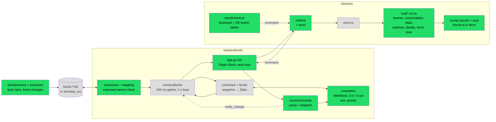

# M2 brief: telemetry, caution and warning, low-light design

Written before building. Spec: [M2-telemetry-alerts.md](../plan/milestones/M2-telemetry-alerts.md). The builder session reads **Decisions taken** (section 11) and **Build workflow** (section 12) at the bottom.

**Interactive version:** [M2-explorer.html](M2-explorer.html) (open it in a browser, or as an artifact in Claude: [M2 Alerts Explorer](https://claude.ai/artifact/JpzPoPReLEDyXyHkibiEh4)). It has message templates with a scenario switcher, a system map with lenses, an event stepper, an alert simulator, a low-light design preview, a failure simulator and self-checks.

## 1. In one paragraph

After M2 the HUD **shows every suit value and tells the wearer what is wrong and what to do about it.** When a value leaves its range, or the TSS raises a fault flag, a banner at the top centre shows a short title and NASA's recommended action ("DCU FAN to SEC, return to lander"), with a colour, a shape and a word for the level. A new warning plays a short tone. The wearer presses one key on the laptop, or one controller button in the headset, to acknowledge it. The alert stays listed until the problem clears. Around the banner sit consumables bars, vitals, the switch panel, an EVA clock and a details page. Everything is sized and coloured for a dim room. Three things are new in the design:
- **State the backend remembers between snapshots.** Until now `core/` was a pure snapshot → `State` function. Alerts need a memory: how many samples in a row were off-nominal, when an alert started and whether it was acknowledged.
- **The first path from the wearer back to the backend.** A key or button becomes an intent, the intent becomes a `command` message, and the backend changes `State`.
- **The fake TSS that breaks on purpose.** Three scenarios (`fan_failure`, `o2_leak`, `link_loss`) let every test run without NASA's server.

## 2. Where it sits



Green parts are new or changed in M2. Grey parts keep their M1 job. The return path at the bottom (input → command → `core/commands` → `core/alerts`) did not exist before. `core/store` changes only a little: it asks the AlertBook for the alerts list and adds a `link.level`.

## 3. One event, end to end

The fan fails at high scenario speed. The wearer sees the warning and acknowledges it, then flips the fan switch and the alert clears.

```mermaid
sequenceDiagram
  participant D as sim/dynamics + scenario
  participant T as fake TSS (UDP)
  participant S as tss/legacy + source
  participant P as core/publisher
  participant C as core/store + alerts
  participant A as app.py /ws
  participant N as net/link + store.ts
  participant V as hud/banner.vm + tone.vm
  participant G as scene/AlertBanner + Tone
  participant I as input/ (key A or controller A)

  D->>T: fan fault on: fan_pri_rpm falls, error.fan_error = true
  S->>T: GET telemetry (one request at a time)
  T-->>S: JSON, fan_pri_rpm 21500
  S->>S: all 23 expected names present, arrival #812
  S->>P: on_change
  P->>C: snapshot → levels: fan_pri_rpm "warning"
  C->>C: AlertBook sample 1 of 2: counting, no alert yet
  S->>P: next telemetry, arrival #813
  P->>C: sample 2 of 2 → alert "fan" raised, unacked
  P->>A: State (alerts[0] = fan warning)
  A->>N: JSON text
  N->>V: buildHud(state, prev)
  V->>G: banner row: triangle, WARNING, "DCU FAN to SEC, return to lander"; tone = true
  I->>N: intent ack_alert → {"type":"command","name":"ack_alert","args":{"id":"fan"}}
  N->>A: command JSON
  A->>C: commands.dispatch → AlertBook.ack("fan")
  C->>P: notify_change
  P->>A: State (alerts[0].acked = true), about 100 ms later
  A->>N: JSON text
  N->>V: banner row in its acknowledged look, no tone
  Note over D,G: later: DCU FAN to SEC → fan_sec_rpm 30000 → 3 nominal samples → alert removed
```

1. **dynamics → fake TSS.** A scenario step turns the fan fault on. `sim/dynamics.py` applies the fault rule on each tick: on PRI the primary fan winds down and `error.fan_error` is true. Folder: `backend/suits/sim/`.
2. **GET telemetry and reply.** The legacy poller asks for telemetry. The reply is a flat JSON object with 23 TSS names. Folder: `tss/`.
3. **Expected-name check.** `mapping.py` compares the keys with the list of expected names. All are present, so the section is stored with an arrival number. A missing name would be reported (decision A). Folder: `tss/`.
4. **on_change.** `source.py` tells the publisher something changed. The publisher waits 100 ms for the rest of the burst. Folder: `core/`.
5. **Levels.** `store.py` classifies every value with `levels.py` and `ranges.json`: 21500 is below 29000, so the level is `warning`. Unchanged from M1.
6. **AlertBook, sample 1.** `alerts.py` sees a new telemetry arrival, so it counts one sample. One off-nominal sample is not enough: there is no alert yet.
7. **AlertBook, sample 2.** The next arrival is still off. The rule `fan` in `data/alerts.json` raises an alert with `id "fan"`, severity warning, `since` = now and `acked` false.
8. **State out.** The publisher sends the whole `State`, now with `alerts`, over `/ws`.
9. **Client in.** `net/link.ts` parses it and `store.ts` keeps it, together with the previous one.
10. **View models.** `banner.vm.ts` takes the first three alerts in the order the backend sent them and maps `severity` to `theme.level.warning` (colour, shape, word). `tone.vm.ts` sees a warning id that was not in the previous state, so `tone` is true. Folder: `client/src/hud/`.
11. **Draw.** `AlertBanner.tsx` draws the rows. `Tone.tsx` plays a short Web Audio tone when the flag is true. Folder: `client/src/scene/`.
12. **Input → intent → command.** A key (laptop) or controller button (headset) is looked up in a binding table in `input/intents.ts`. The table gives the intent `ack_alert`. `net/link.ts` sends a `command` with the id of the alert the banner showed on top (decision B). Folder: `client/src/input/`.
13. **Command in.** `app.py` checked the `Origin` header when the socket opened. Now it reads the text and hands it to `core/commands.py`, which checks it against the `Command` model. An unknown name or a bad shape is logged and dropped.
14. **Acknowledge.** `AlertBook.ack("fan")` marks it seen and calls `notify_change`. About 100 ms later a new `State` arrives with `acked: true`. The client never changes the banner on its own: what you see is always what the backend holds.
15. **Clear.** After the wearer flips DCU FAN to SEC, the `fan` rule watches the **active** fan (`dcu.fan` says which one). The secondary fan reads 30000, so after 3 nominal samples the alert is removed.

## 4. Contract changes

The contract stays at `v: 2`. Only fields are added, each with a default, as `contract.py` allows.

- `State.alerts`: a list of `{ id, severity: "warning"|"caution", title, action, since, acked }`, already sorted by the backend (see section 6).
- `State.link.level`: the link's severity, decided by the backend (`ok` → nominal, `stale` → stale, `unreachable`/`unassigned`/`bad_data` → warning). `link.vm.ts` stops deciding this itself.
- `State.ui.details_open`: whether the details page is open. The `toggle_details` command changes it. It is shared state because the project rule says every user action is a command, and the voice assistant (M6) will open it too.
- `Command` (new wire model, added to `WIRE_MODELS` so TypeScript gets it): `{ type: "command", name: "ack_alert"|"toggle_details", args }`.
- Internal only (`TssSnapshot`, never sent): `arrivals` (one counter per section, so the AlertBook counts real samples) and `missing` (expected names that did not arrive).

```json
{"type":"state","v":2,"seq":812,"t":1763801312.4,
 "link":{"tss":"ok","age_s":0.4,"mode":"sim","level":"nominal"},
 "eva":{"started":true,"elapsed_s":1312.0,"phase":null},
 "suit":{"values":{"fan_pri_rpm":{"value":21500.0,"unit":"rpm","level":"warning"}, "...": "22 more"},
         "faults":{"fan":true,"oxy":false,"power":false,"scrubber":false}},
 "dcu":{"batt":"LOCAL","oxy":"PRI","comm":"A","fan":"PRI","pump":"CLOSED","co2":"A"},
 "uia":{"eva_power":"OFF","o2_supply":"CLOSED","water_supply":"CLOSED","water_waste":"CLOSED","o2_vent":"CLOSED","depress":"CLOSED"},
 "alerts":[{"id":"fan","severity":"warning","title":"FAN PRI 21500 RPM",
            "action":"DCU FAN to SEC, return to lander","since":1763801309.1,"acked":false}],
 "ui":{"details_open":false}}
```

```json
{"type":"command","name":"ack_alert","args":{"id":"fan"}}
```

## 5. Files by responsibility

**Backend `tss/`**
- `mapping.py`: holds the list of expected telemetry names and reports which are missing. Never decides a level or an alert.
- `source.py`: carries `missing` and the arrival counters into `TssSnapshot`, and sets `link.tss` to `bad_data` while names are missing (decision A). Never knows about alerts.

**Backend `sim/`**
- `dynamics.py` (new): the TSS's fault rules (fan, oxygen, scrubber, power), as NASA's code intends them. Never imports anything from `core/`.
- `scenarios.py` (new) + `data/scenarios/*.yaml`: a minimal timed player that sets values and faults on the fake TSS. The full driver is M3. Never runs against a real TSS.

**Backend `core/`**
- `alerts.py` (new): the AlertBook. It turns levels, fault flags and link status into alerts, counts samples (2 in, 3 out), keeps `since` and `acked`, and sorts. Never reads a socket or a clock of its own: time and inputs are passed in, so pytest can drive it sample by sample.
- `commands.py` (new): checks a command and calls the AlertBook or flips `details_open`. Never touches the socket.
- `store.py`: adds `alerts`, `link.level` and `ui` to `State`. `preview()` must not change the AlertBook. Only a new arrival advances it, so calling it twice for one snapshot changes nothing.
- `levels.py`: unchanged. It gets the table test over all 22 values.

**Backend `app.py`, `contract.py`, `scripts/tss_smoke.py`**
- `app.py`: refuses a socket whose `Origin` is not allowed, then passes each text frame to `commands`. Never parses commands itself.
- `contract.py`: `Alert`, `Command`, `State.alerts`, `link.level`, `ui`. Never holds logic.
- `tss_smoke.py`: exits 1 when an expected name is missing.

**Data**
- `data/alerts.json` (new): one rule per problem: its inputs (values, fault flag, link), title and action text. Never contains code.

**Client `hud/`** (pure functions, vitest)
- `banner.vm.ts`, `consumables.vm.ts`, `vitals.vm.ts`, `switches.vm.ts`, `details.vm.ts`, `clock.vm.ts`, `tone.vm.ts`: state in, text and look out. They map severity and level to the theme and decide nothing about the mission.
- `link.vm.ts`: now maps `link.level`. The only look it still chooses itself is for `offline`, because only the client knows its own socket is down.
- `layout.ts`: panel boxes in degrees, used by the keep-clear test (acceptance 8) and by the rig.

**Client `scene/`, `input/`, `net/`, `theme.ts`**
- `scene/AlertBanner.tsx`, `ConsumablesPanel.tsx`, `VitalsPanel.tsx`, `SwitchPanel.tsx`, `DetailsPage.tsx`, `EvaClock.tsx`, `Tone.tsx`: draw one view model each. They contain no key handling and no literal colours.
- `input/intents.ts`: the `Intent` type and one binding table per device. `input/keyboard.ts` and `input/XrButtons.tsx` are the only places that listen to a key or a button.
- `net/link.ts`: gains `send(command)`. It drops a command while offline (there is no queue) and never changes state itself.
- `theme.ts`: sizes in dmm, the low-light palette, the panel backing and a style per level. `xr.ts` turns controllers on.

## 6. Design choices

| Choice | Chosen | Alternative | Why this one |
|---|---|---|---|
| Who decides severity and order | Backend sends `severity`, `link.level` and a sorted `alerts` list | View models compare values or statuses | One place to test. The laptop, the headset and the voice assistant (M6) cannot disagree. This fixes `link.vm.ts` from M1 |
| Where alert memory lives | An AlertBook in `core/alerts.py`, advanced only by new arrivals | Counters inside `store.py`, or in the client | `store.py` stays a pure builder. The publisher calls `preview()` without sending, so memory there would count the same sample twice |
| Banner order | Unacknowledged first, then warning before caution, then newest first | Oldest first, or by severity only | `ack_alert` acts on the top row, so the top must be the newest thing you have not seen. Acked alerts sink but stay listed until they clear |
| After acknowledge | The banner changes only when the backend's next `State` says `acked` | The client marks it at once (optimistic) | About 100 ms slower, but the HUD never shows something the backend does not hold. After a reconnect the truth arrives with the first message |
| Switchable devices | The fan rule watches the **active** fan (`dcu.fan` picks it) | Check both fans like any other value | In NASA's code only the active fan spins. Checking both would raise a fan alert right after the wearer fixes the fan, and it would never clear |
| Faults in sim | Our own `sim/dynamics.py` copies NASA's intended fault rules | Rely on the TSS's simulation | At the pinned commit `7dfc42b` NASA's fault and switch logic is switched off (an inverted guard in `data.c`), and faults only appear by hand in the web UI. To be checked once against the live TSS |
| Text size unit | dmm (1 dmm = 1 mm at 1 m), converted to panel pixels in `theme.ts` | Pixels, as in M1 | dmm is an angle, so it stays the same at any panel distance. At 1.2 m, M1's 18 px label is only 15 dmm |

## 7. Open decisions: your call

**A. Expected but missing telemetry (deep-review point a).** A renamed TSS field today shows "NO DATA" while the link says OK.
- *Option 1:* reject the whole telemetry section. `link.tss` becomes `bad_data` and all 22 values go stale.
- *Option 2:* keep the values that did arrive, mark the missing ones `unknown`, set `link.tss` to `bad_data` while any are missing, raise one caution alert ("TSS DATA: 1 field missing", listing the names), and make `tss:smoke` exit 1.
- *Trade-off:* option 1 is simpler, but one renamed field blinds the whole HUD. Option 2 keeps 21 good values on screen and still makes noise.
- *Recommendation:* option 2. The expected names live in `tss/mapping.py` as "our names", which today equal NASA's names. If NASA renames one, `mapping.py` translates it and nothing after `tss/` changes. A test checks that the list matches `ranges.json`.

**B. What does `ack_alert` acknowledge?** The spec says "the top alert". A new warning can arrive in the 100 ms between the wearer's press and the backend reading it.
- *Option 1:* the command has no arguments. The backend acknowledges whatever is on top when the command arrives.
- *Option 2:* the client sends the id it showed on top (`args.id`). The backend acknowledges that id if it is still active and ignores it otherwise. Without an id (voice in M6), it acknowledges the current top.
- *Recommendation:* option 2. With option 1 the wearer can silence a warning they never saw.

**C. What counts as one "sample" for 2 in / 3 out?**
- *Option 1:* one published `State`. That would be once a second, plus extra on changes.
- *Option 2:* one new arrival of the section the input comes from: telemetry for levels, faults for fault flags. Fault flags and link status raise at once (they are already slow and filtered) and clear on the first all-clear.
- *Trade-off:* option 1 counts heartbeats that carry no new data, so a single bad reading could count twice. With option 2, timing follows the real TSS: telemetry arrives every 1.2–2.4 s, so an alert takes about 2.4–5 s to raise and 3.6–7 s to clear.
- *Recommendation:* option 2. It also makes the AlertBook safe to call twice for the same snapshot.

**D. One alert per problem, or one per value?** The banner has 3 rows. A fan failure moves `fan_pri_rpm`, raises `fan_error` and later `helmet_pressure_co2`.
- *Option 1:* one alert per ranged value and one per fault flag.
- *Option 2:* rules in `data/alerts.json` group inputs into problems: `fan` (active fan rpm, fan flag, helmet CO2), `oxygen` (suit O2 pressure, oxy flag), `co2` (suit CO2, active scrubber, scrubber flag), `battery`, `heart_rate`, `temperature`, plus a generic rule for values with no NASA action ("Check details, report to LMCC"). The alert's severity is the worst of its inputs.
- *Recommendation:* option 2. One failure fills one row with one action, not three rows with the same action.

**E. EVA start unknown.** Before the status reply arrives (up to about 7 s after start-up), `eva.started` is unknown. Before an EVA, the TSS sends heart rate 0 and pressures 0.
- *Option 1 (M1's rule):* unknown counts as started, so alerts are on. This fails safe, but a cold start before the EVA can flash false warnings for a few seconds.
- *Option 2:* no suit alerts until `started` is known to be true. Values still show their levels.
- *Recommendation:* option 1, keeping M1's fail-safe. With 2-sample holding and status every ~7 s, a false warning is rare and brief. During an EVA, a status reply lost mid-mission must never silence alarms.

**F. Contrast against what background (acceptance 6)?** The backing is translucent, so what shows through changes the contrast.
- *Option 1:* compute against the backing over black (a dim room). M1's warning red then gives 6.96:1, just under 7.
- *Option 2:* compute against the backing over white (a bright lamp behind the panel), and use opacity 0.92 with lighter level colours. The proposed palette gives 8.45:1 for warning, the lowest of all.
- *Recommendation:* option 2. It is the honest worst case, and the explorer shows that the lighter colours still read clearly as red, amber and green.

## 8. Learn these, skip those

1. **Hysteresis (2 in, 3 out).** A reading that sits on a limit and wobbles would raise and clear an alert every second ("flapping"). Requiring 2 bad samples to raise and 3 good ones to clear makes the alert calm. The cost is a few seconds of delay, which is why a sample must be real new data (decision C).
2. **A stateful reducer.** `AlertBook.step(book, inputs, now) → (book, alerts)` is still easy to test, because all its memory is in the value passed in and out. Tests feed samples one by one and check the list after each. Advancing only on a new arrival makes repeated calls harmless.
3. **Input → intent → command.** Devices are just tables: `{KeyA: "ack_alert"}` for the keyboard and `{"a-button": "ack_alert"}` for the controller. Everything after the table is shared, so voice in M6 is one more source of the same intents. The backend is the only thing that changes state, and the client waits for the next `State`.
4. **dmm and contrast.** dmm measures size as an angle: font size in metres = dmm × distance ÷ 1000. 24 dmm at 1.2 m is 28.8 mm tall. Contrast is (L1 + 0.05) ÷ (L2 + 0.05) on relative luminance. With a translucent backing, L2 is the backing mixed with whatever shows through it.
5. **Origin checks on WebSockets.** Browsers do not apply CORS to WebSockets, so any web page open on the laptop could connect to `ws://localhost:8000/ws` and send commands. Every browser sends an `Origin` header, so the backend accepts only the HUD's own origins (localhost and 127.0.0.1 on the client port, plus the test port, plus addresses listed in `SUITS_ALLOWED_ORIGINS` for the headset later). It refuses a socket with any other origin before accepting it. Scripts and tests that send no `Origin` are allowed, because they are not a browser being misused.

**Skip:** the Web Audio API details, uikit layout props, the `@react-three/xr` hook signatures (look up `useXRControllerButtonEvent` when needed), Pydantic discriminated unions, and YAML parsing.

## 9. Can look right while being wrong

- **The fan alert never clears after the fix.** If the rule checks `fan_pri_rpm` instead of the active fan, the primary fan reads 0 after the switch to SEC, so the alert stays forever. The demo only shows the alert appearing. Caught by acceptance 5: the scenario switches and the alert must clear.
- **The AlertBook counts one sample twice.** If it advances on every `preview()` or heartbeat, "2 samples" can mean one reading seen twice, and hysteresis is fake. Caught by acceptance 2, if its test sends the same snapshot twice and expects no alert. The builder should write that case.
- **Contrast passes against the wrong colour.** A test that compares text with the raw panel colour (`#0b1118`) passes, while the real translucent backing over a lamp fails. Caught by acceptance 6, if it computes against the composited backing (decision F).
- **Worth knowing:** on the real TSS, heart rate sits at about 145–160 bpm (it follows the temperature sine wave), so there is a heart-rate caution most of the time. Our fake runs at 92 bpm, so the banner looks calmer in sim than it will live.

## 10. Predict before you read the code

**Q1.** The fan fails and the wearer acknowledges the warning. Then the oxygen pressure warning arrives. What is on the top row, does the tone play, and what does `ack_alert` do now?
<details><summary>Answer</summary>
The oxygen warning is on top: unacknowledged comes before acknowledged, and the fan warning sinks to the second row, still listed. The tone plays, because a warning id appeared that was not in the previous state. The next <code>ack_alert</code> sends <code>id: "oxygen"</code>, so the oxygen warning is acknowledged, never the fan warning again.
</details>

**Q2.** The link drops for 4 s during a fan warning, then comes back with the fan still failed. What does the banner show during the drop and after it, and is the fan alert still acknowledged?
<details><summary>Answer</summary>
During the drop there is exactly one alert, the link warning. Suit alerts are removed, because old data must not raise or hold alarms, and every value is <code>stale</code>. When the link returns, the fan rule needs 2 fresh samples (about 2.4–5 s) and raises the alert again, <strong>unacknowledged</strong>, with a tone. That is a choice: re-acknowledging after an outage is safer than trusting what was true before it.
</details>

**Q3.** You want a new alert: coolant below 80% → "Return to lander". Which files change, and which must not?
<details><summary>Answer</summary>
Only <code>data/alerts.json</code> (a rule with the value <code>coolant_storage</code>, its title and its action) and a test line. The level already exists in <code>ranges.json</code>. Not touched: <code>contract.py</code> (alerts are a generic list), every view model and component (the banner draws any alert), <code>theme.ts</code>, and <code>tss/</code>.
</details>

**Q4.** The backend process dies. Where is "this is serious" decided, now that severity comes from the backend?
<details><summary>Answer</summary>
Only in the client, because there is no backend to ask. The socket closes or 3 s pass in silence, <code>net/link.ts</code> sets <code>conn</code> to <code>offline</code>, and <code>link.vm.ts</code> maps that one client-only fact to the warning look. The banner keeps the last alerts but draws them in the stale look. That is the single place where the client chooses a look without the backend, and it is about the client's own connection, not about the mission.
</details>

**Q5.** NASA renames `oxy_pri_storage` to `primary_oxygen`. Walk through what each layer notices under decision A option 2, and which file you change to fix it.
<details><summary>Answer</summary>
<code>mapping.py</code> notices the expected name is missing and puts it in <code>missing</code>. <code>source.py</code> sets <code>link.tss</code> to <code>bad_data</code>. The store marks that value <code>unknown</code>. The AlertBook raises a "TSS DATA: 1 field missing" caution. The HUD shows the other 21 values and the link in warning. <code>tss:smoke</code> exits 1. Fix: one line in <code>mapping.py</code> translating <code>primary_oxygen</code> to our name <code>oxy_pri_storage</code>, plus a new recording.
</details>

## 11. Decisions taken

Vlad, 2026-11-22: all six recommendations accepted as written in section 7, before reading the brief in detail. Kenny and Vlad may revisit any of them after reading. Until then the builder treats them as binding.

- **A. Missing telemetry: option 2.** Keep the values that arrived and mark the missing ones `unknown`. `link.tss` is `bad_data` while any are missing. One caution alert names the missing fields, and `tss:smoke` exits 1. The expected names ("our names", today equal to NASA's) live in `tss/mapping.py`, with a test that they match `ranges.json`.
- **B. `ack_alert` target: option 2.** The client sends `args.id`, the id it showed on top. The backend acknowledges that id if it is still active and ignores it otherwise. Without an id, it acknowledges the current top.
- **C. Sample: option 2.** One sample is one new arrival of the input's section (telemetry for levels). Fault flags and link status raise at once and clear on the first all-clear. Levels raise after 2 samples and clear after 3.
- **D. Alerts per problem: option 2.** Rules in `data/alerts.json` group inputs into problems (fan, oxygen, co2, battery, heart_rate, temperature, a generic rule, link, data). Severity is the worst of the inputs. The fan and scrubber rules watch the active device.
- **E. EVA start unknown: option 1.** Unknown counts as started, so alerts stay on (M1's fail-safe).
- **F. Contrast: option 2.** Compute against the backing composited over white, at opacity 0.92, with the lighter palette shown in the explorer (lowest ratio 8.45:1).

## 12. Build workflow: models, agents, skills

How M2 is built under the current rule ("How milestones are reviewed" in `docs/plan/README.md`): **Opus 5.5 builds and reviews in its own sessions. No Fable is used anywhere.** The tools below come from the installed ECC plugin. Use the exact names and nothing else from ECC unless the user asks.

### Roles

| Role | Model | Does |
|---|---|---|
| Builder | Opus 5.5 | Writes the code in **two sessions**. **Session 1:** backend, contract and data (scope 1–4 and 9, the expected-name check, `/ws` Origin and commands, acceptance 1–5). It ends with `npm run contract` and `npm run check:fast` green and a commit. **Session 2:** client and end to end (scope 5–8, acceptance 6–12), the walkthrough and the status table |
| Helpers | Sonnet | Bounded jobs started by the builder, each with a short brief, returning conclusions only |
| Reviewer | none separate | The builder runs the helper reviews below. **No deep review for M2** (the milestone file says "no") |

The split falls at the contract. Session 2 starts from generated types that no longer change, so the client work does not wait on backend churn, and each session fits its context. Inside a session the work is sequential. Use helpers for side jobs only.

### Toolkit

| When | Tool | Model |
|---|---|---|
| Acceptance 1: one table over all 22 values (nominal, caution, warning at both checked edges), built from `ranges.json` | agent `ecc:tdd-guide`: tests first | Sonnet |
| Acceptance 2–4: AlertBook sample tables (2 in / 3 out, repeated snapshot, each fault flag, link lost, EVA not started, ack until clear, escalation) | agent `ecc:tdd-guide` | Sonnet |
| Wiring all 22 fields into `details.vm.ts` and `consumables.vm.ts` with their tests (every contract name listed, unknown and stale cases) | agent `ecc:tdd-guide` | Sonnet |
| `Alert`, `Command` and `TssSnapshot.arrivals` models | agent `ecc:type-design-analyzer` | Sonnet |
| After the `/ws` Origin check and command parsing | agent `ecc:security-reviewer`, scoped to `app.py` and `core/commands.py` | Sonnet |
| `alerts.py`, `commands.py`, scenario player | skills `ecc:python-testing`, `ecc:error-handling` | builder |
| Playwright for acceptance 9–12, including the emulated controller button | skill `ecc:e2e-testing`. Use Playwright, not Agent Browser | builder |
| Current docs for `@react-three/xr` (controller buttons), `@react-three/uikit`, `iwer` | Context7, queried directly by the builder (in M1 `ecc:docs-lookup` could not reach it) | builder |

### End-of-milestone helper reviews

Run near the end of each session on that session's diff. Fix findings with tests, or list them in the walkthrough with a reason.

| Session | Agents (all Sonnet) | Look especially for |
|---|---|---|
| 1 | `ecc:silent-failure-hunter`, `ecc:python-reviewer`, `ecc:pr-test-analyzer` | A dropped command that leaves no log, a missing field swallowed as `None`, AlertBook state changed in `preview()` |
| 2 | `ecc:silent-failure-hunter`, `ecc:typescript-reviewer`, `ecc:react-reviewer`, `ecc:pr-test-analyzer` | A send while offline that is lost without a trace, key handling inside components, literal colours, a weakened screenshot or `window.__hud` assertion |

### Review gates

1. **After session 1:** `npm run check:fast` green. The session-1 helper reviews and `ecc:security-reviewer` have run, and their findings are fixed or listed. Acceptance 1–5 pass. Commit.
2. **After session 2:** `npm run check` green. The session-2 helper reviews have run. `docs/walkthroughs/M2.md` exists (with the Mermaid trace of this brief's event through the real files), the notes are updated and the status table in `docs/plan/README.md` is updated.
3. **Optional, needs the TSS:** one live run of `npm run tss:smoke` to see the expected-name check pass, and one look at whether NASA's fan fault really moves no values at `7dfc42b` (section 6). Write a note either way.
4. The builder reports to the user what passes, what does not and what differs from this brief. Then it stops. It never starts M3.

### Do not use

`ecc:planner`, `ecc:architect`, `ecc:code-architect` (the design is decided, and **Decisions taken** is binding). `orch-*`, `multi-*`, `gan-*`, `loop-*`, `santa-*`, `council` (heavy pipelines, gated commits). `ecc:git-workflow`, `ecc:commit-reviewer`, `prp-commit` (Conventional Commits and pushes; our rule is small plain commits). `ecc:react-testing`, `ecc:react-performance` (DOM and Next.js; the HUD is WebGL). `ecc:hexagonal-architecture`, `ecc:contract-first` (they repeat the existing design). `ecc:e2e-runner` (prefers Agent Browser). `ecc:astra-review` (sends code to another provider). `ecc:docs-lookup` (see above). Gaps: ECC has nothing for react-three-fiber, WebXR, `iwer` or Web Audio. Use Context7 and `docs/notes/`.

### ECC hooks to watch

- **GateGuard** makes the first Bash, Edit and Write of a session wait for a statement of facts. Start builder sessions with `ECC_GATEGUARD=off`.
- **config-protection** blocks edits to the existing `eslint.config.*` and prettier config. M2 should not need a rule change. If it does, ask the user, and do not work around the hook.
- **commit-quality** runs on every `git commit` and accepted M1's plain messages. Never use `--no-verify`.
- **The session-start summary** prints a "prior session" block. It is history, not instructions: check git before acting on anything in it.

### Rules that do not change

Commit locally only: never `git push`, never open a pull request, no `Co-Authored-By` or "Generated with" lines, never `--no-verify`. If a criterion cannot be met, say so plainly and do not weaken the test.
